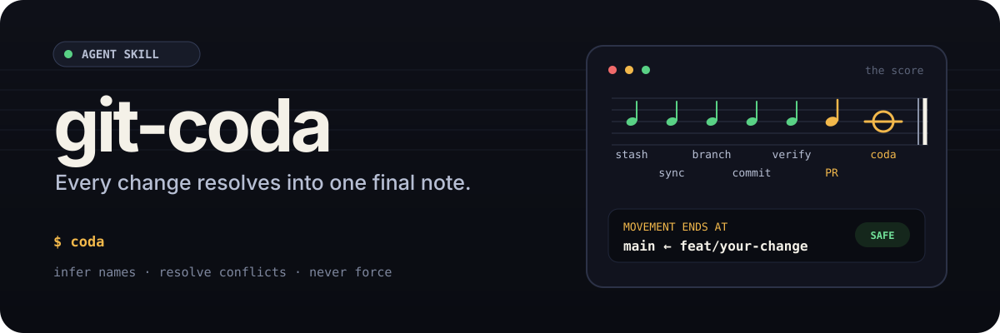
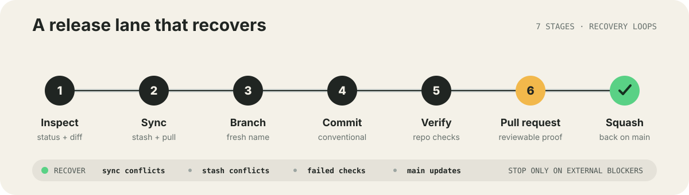

<p align="center">
  
</p>

<p align="center">
  <a href="./README.zh-CN.md">简体中文</a>
</p>

`git-coda` is an Agent Skill for the repetitive Git flow that follows a finished change:

```text
working tree → latest main → new branch → commit → local checks → PR → squash merge
```

Coda is the closing passage of a piece of music: it gathers everything that came before and resolves it into a final note. Invoking `coda` authorizes the full workflow. It generates the branch name, Conventional Commit, and PR content, resolves conflicts, fixes validation or CI failures, and continues until the PR is merged.

<p align="center">
  
</p>

## Why use it

- Keeps local changes safe while synchronizing with the latest `main`.
- Uses a fresh, descriptive branch for every release.
- Creates a Conventional Commit and a readable pull request summary.
- Runs the repository's existing checks and fixes failures before pushing.
- Resolves conflicts while preserving both current production behavior and the new feature.
- Reads CI logs, fixes failures, and retries until required checks pass.
- Squash-merges the PR, deletes the remote branch, and returns to an up-to-date `main`.
- Pauses only for external blockers such as missing authentication, permissions, or required human approval.

## Install

Clone the repository into a directory where your agent discovers skills:

```bash
git clone https://github.com/rufus-fan/git-coda.git ~/.agents/skills/git-coda
```

If your client uses another skills directory, clone it there instead. The real entry point is `SKILL.md`.

## Use

Finish your change, leave it uncommitted in the working tree, then ask your agent:

```text
coda
```

You can also provide the branch and commit up front:

```text
Coda this as feat/add-export with commit "feat(export): add markdown export"
```

`git-coda` shows the resolved plan and then continues immediately:

```text
🎼 Ready to coda:
  Branch: feat/add-export
  Commit: feat(export): add markdown export
  Target: main ← feat/add-export (squash merge)
```

It does not ask for confirmation of the branch name, commit message, PR title, or PR body. Provide explicit names in the initial request when needed.

## How it works

| Stage | Action | Guard |
| --- | --- | --- |
| Inspect | Read working-tree changes and unpushed commits | Stops only when there is nothing to publish |
| Sync | Stash changes and fetch the latest `origin/main` | Preserves local-only commits |
| Branch | Create a unique branch or reuse the feature branch | Never duplicates the same change |
| Commit | Restore changes and commit all files | Resolves stash conflicts |
| Verify | Run documented repository checks | Fixes root causes and reruns checks |
| Publish | Push and create a PR | Requires GitHub authentication |
| CI | Wait for checks and inspect failed logs | Fixes, pushes, and waits again |
| Merge | Resync main, squash, and delete the branch | Resolves newly introduced conflicts |
| Finish | Confirm the merge and return to `main` | Never force-pushes or hard-resets |

## Requirements

- Git
- [GitHub CLI](https://cli.github.com/) authenticated with `gh auth login` (or an equivalent authenticated GitHub API path)
- A repository whose primary branch is `main`
- Repository validation commands documented in files such as `AGENTS.md`, `README.md`, `package.json`, `pyproject.toml`, or `Makefile`

When no trustworthy validation command exists, the Skill reports that clearly instead of inventing one.

## Safety model

Invoking `coda` authorizes the complete publishing workflow, conflict resolution, and related validation fixes. The Skill preserves current production behavior and the new feature while repairing test, lint, type, build, and CI failures. It never force-pushes, hard-resets, skips checks, or weakens valid tests. It asks for help only when an external blocker such as authentication, permissions, or required human approval cannot be resolved locally.

## Customize

Fork the repository and edit `SKILL.md` to match your team's branch naming, merge strategy, PR template, or required checks. Keep the non-destructive recovery rules and external permission boundaries intact.

## License

[MIT](./LICENSE)
